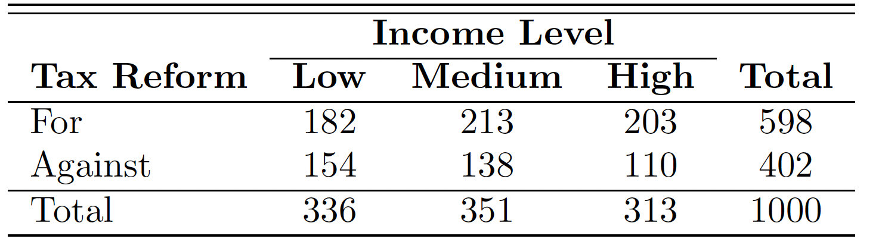
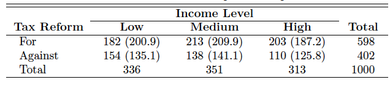

```{r setup, echo=FALSE}
knitr::opts_chunk$set(echo = TRUE,comment = '', fig.align = 'center'  , out.width="70%")
```

```{r packages, message = FALSE}
library(ggplot2)
library(MASS)
```


## Reference

1. Probability & Statistics for Engineers & Scientist, 9th Edition, Ronald E. Walpole, Raymond H. Myers, Sharon L. Myers, Keying Ye, Prentice Hall

2. Chi-squared Test of Independence, http://www.r-tutor.com/elementary-statistics/goodness-fit/chi-squared-test-independence

3. Understanding ANOVA in R, https://bookdown.org/steve_midway/DAR/understanding-anova-in-r.html

## Outline
- Association
  * Categorical and Continuous Variables
     - ANOVA Test
  * Categorical and Categorical Variables
    - Chi-squared Test
    - Cramer's V (phi) Coefficient


## Association


### Association between One Numerical Variable and One Categorical Variable


### One-Way Analysis of Variance (ANOVA)

**One-way ANOVA** is used to compare the population means of a numerical response variable across two or more groups defined by one categorical explanatory variable. Although ANOVA stands for *Analysis of Variance*, its main purpose here is to test whether the **group means** are equal.

For $k$ groups, we test

$$
H_0: \mu_1=\mu_2=\cdots=\mu_k
$$

$$
H_a: \text{At least one population mean is different.}
$$

A significant ANOVA result does **not** tell us which particular groups differ. It also does not, by itself, establish a causal relationship.

#### How does ANOVA work?

ANOVA compares two sources of variation:

- **Between-group variation:** How far are the group sample means from the overall (*grand*) mean?
- **Within-group variation:** How far are individual observations from their own group sample mean?

Let $x_{ij}$ denote observation $j$ in group $i$, $n_i$ the sample size of group $i$, $\bar{x}_i$ its sample mean, and $\bar{x}$ the grand mean. There are $k$ groups and $N=\sum_{i=1}^k n_i$ observations in total.

$$
SS_{\mathrm{between}}=\sum_{i=1}^{k} n_i(\bar{x}_i-\bar{x})^2
$$

$$
SS_{\mathrm{within}}=\sum_{i=1}^{k}\sum_{j=1}^{n_i}(x_{ij}-\bar{x}_i)^2
$$

Dividing each sum of squares by its degrees of freedom gives the **mean squares**:

$$
MS_{\mathrm{between}}=\frac{SS_{\mathrm{between}}}{k-1},\qquad
MS_{\mathrm{within}}=\frac{SS_{\mathrm{within}}}{N-k}.
$$

The ANOVA test statistic is

$$
\boxed{F=\frac{MS_{\mathrm{between}}}{MS_{\mathrm{within}}}.}
$$

Under $H_0$ and the usual ANOVA assumptions, both mean squares estimate the same population variance. Thus, an unusually large $F$ provides evidence against $H_0$.

**Small numerical example.** Suppose the observations in three groups are A: $(2,4,6)$, B: $(5,7,9)$, and C: $(8,10,12)$. Their means are $4$, $7$, and $10$; the grand mean is $7$.

$$
SS_{\mathrm{between}}=3(4-7)^2+3(7-7)^2+3(10-7)^2=54
$$

$$
SS_{\mathrm{within}}=8+8+8=24
$$

Therefore, $MS_{\mathrm{between}}=54/2=27$, $MS_{\mathrm{within}}=24/6=4$, and $F=27/4=6.75$.

```{r}
group <- factor(rep(c("A", "B", "C"), each = 3))
value <- c(2, 4, 6, 5, 7, 9, 8, 10, 12)
summary(aov(value ~ group))
```

#### Assumptions of One-Way ANOVA

1. **Independence:** Observations are independent within and across groups.
2. **Normality:** The errors (or equivalently, the response within each group) are approximately normally distributed. This does **not** mean that all observations pooled together must follow one normal distribution.
3. **Equal variances:** The population variances are equal across groups.

ANOVA can be reasonably robust to moderate departures from normality, especially with sufficiently large group sizes. However, strong outliers, substantial skewness, or unequal variances combined with unbalanced group sizes may affect the reliability of the p-value. **Welch's ANOVA** relaxes the equal-variance assumption and can be performed in R using `oneway.test()`; it does not automatically resolve problems caused by extreme outliers or severe non-normality.

**Example 1: `Boston` Data**

Let's use the `Boston` data set from the `MASS` package.

- `medv`: Median value of owner-occupied homes in $1000s.
- `chas`: Charles River dummy variable (1 if the tract bounds the river; 0 otherwise).

We want to compare the mean `medv` for the two groups defined by `chas`.

```{r}
ggplot(data = Boston, aes(x = factor(chas), y = medv)) +
  geom_boxplot() +
  labs(x = "Bounds Charles River (chas)", y = "Median home value ($1000s)")
```

```{r}
aov1 <- aov(medv ~ factor(chas), data = Boston)
summary(aov1)
```

**Reading the ANOVA table:**

- **Df:** Degrees of freedom, $k-1$ for the groups and $N-k$ for residuals.
- **Sum Sq:** Between-group and within-group sums of squares.
- **Mean Sq:** Sum Sq divided by the corresponding Df.
- **F value:** Between-group Mean Sq divided by residual Mean Sq.
- **Pr(>F):** The p-value for the F-test under the null hypothesis.

**Interpretation:** The ANOVA table reports $F = 15.97$ and $p < 0.001$. At the 5% significance level, we reject $H_0$. There is statistically significant evidence that the population mean `medv` differs between tracts that border the Charles River and those that do not. This result establishes an **association**, not that proximity to the river causes the difference in home values.

Since there are only two groups, this example connects to the two-sample t-test. The next example illustrates ANOVA with **more than two groups**.

**Example 2: Revisit the EDA Dataset `diamonds`**

Recall that the `diamonds` data set contains variables including:

- `price`: Price in US dollars.
- `carat`: Weight of the diamond.
- `cut`: Quality of the cut (Fair, Good, Very Good, Premium, Ideal).
- `color`: Diamond color, from D (best) to J (worst).
- `clarity`: A measure of clarity.

We want to investigate whether the **mean price** differs across the five `cut` categories.

```{r boxplot, out.width = "50%", out.height = "50%"}
ggplot(data = diamonds, aes(x = cut, y = price)) +
  geom_boxplot()
```

What can you tell from the boxplot? Are the distributions similar in spread?

```{r}
aov2 <- aov(price ~ cut, data = diamonds)
summary(aov2)
```

**Interpretation:** The ANOVA test reports $F = 175.7$ and $p < 0.001$. At the 5% significance level, we reject $H_0$ that the five population mean diamond prices are equal. There is statistically significant evidence that **at least one cut category has a different population mean price**. The ANOVA test alone does not tell us which categories differ.

However, the boxplots show substantial overlap among the price distributions. Thus, a very small p-value does **not** necessarily mean that the differences are large or practically important. The sample size is very large, which can make relatively small differences statistically detectable. Moreover, `carat` and other diamond characteristics may be associated with both `cut` and `price`. This one-way ANOVA does **not** show that cut quality causes changes in price.

**Key takeaway:** Statistical significance is not the same as practical significance.

We can inspect the residuals and consider an unequal-variance alternative:

```{r}
plot(aov2, which = 2)  # Normal Q-Q plot of residuals
oneway.test(price ~ cut, data = diamonds, var.equal = FALSE) # Welch ANOVA
```

#### In-Class Exercise: ANOVA Test

- Perform a one-way ANOVA for `Petal.Length` across `Species` in the `iris` data set. State $H_0$ and $H_a$ and interpret the p-value.
- Perform a one-way ANOVA for `salary` across `sex` in the `Salaries` data set. Repeat using `rank` as the categorical variable. What do you conclude? (`Salaries` is in the `carData` package.)


### Associations between Categorical Variables

### Chi-squared  Test

We can use *Chi-squared Test*to determine *if a population has a specified theoretical distribution*. We can also  use `Chi-squared Test` to check the independence of two categorical features/attributes. 

- $H_0$: (**null hypothesis**) The two variables are independent.
- $H_1$: (**alternative hypothesis**) The two variables are dependent.

We need the **contingency table**. **Contingency table** is a table with observed frequencies. Let's see the following example.

**Example 1.**
Suppose that
we wish to determine whether the opinions of the voting residents of the state
of Illinois concerning a new tax reform are independent of their levels of income.
Members of a random sample of 1000 registered voters from the state of Illinois
are classified as to whether they are in a low, medium, or high income bracket and
whether or not they favor the tax reform.

 The following is $2 \times 3$ contingency table.

```{r,echo = FALSE}

```

Assuming the independence, the expected frequence is given by the following formula:
$$ \text{expected frequency} = \frac{(\text{column total})\times (\text{row total})}{\text{grand total}}$$

Thus, we have the following table. 

```{r,echo = FALSE}

```

Based on the table, we can also calculate the $\chi^2$ value. Here, we omit the process.

How to use `chisq.test`?

```{r} 
# Manually enter the data
taxreform <- rbind(c(182,213,203), c(154,138,110))
dimnames(taxreform) <- list(
  reform = c("For", "Against"), 
  IncomeLevel = c("Low","Medium", "High"))
# display the data
taxreform 
# chi-square test
chitest1 <- chisq.test(taxreform)
chitest1
```

Based on the result, the null hypothesis is rejected and we conclude that a voter’s opinion concerning the tax reform and his or her level of income are not independent.

Why degree freedom is 2? Actually
$$ v = (r-1)(c-1),$$
where $r$ is # of rows and $c$ is # of columns.


#### Revisit the EDA dataset `diamonds` again

Here we want to investigate the relationship between `cut` and `clarity`.

```{r}
# Create contingency table
cutclarity<-table(diamonds$cut,diamonds$clarity)

# Conduct Chi-squared Test
chisqtestResult1<- chisq.test(cutclarity)
chisqtestResult1
```

Since we get a p-value less than the significance level of 0.05, we should reject the null hypothesis and conclude that the two variables are dependent.

Let's also check the relationship between `cut` and `color`.

```{r}
# Create contingency table
cutcolor<-table(diamonds$cut,diamonds$color)

# Conduct Chi-squared Test
chisqtestResult2<- chisq.test(cutcolor)
chisqtestResult2
```

Here, we also get a pretty small p-value less than the significance level of 0.05.

However, a problem with Pearson’s $\chi^2$ coefficient is that the range of its maximum value depends on the sample size and the size of the contingency table. These values may vary in different situations. To overcome this problem, **the coefficient can be standardized to lie between 0 and 1** so that it is independent of the sample size as well as the dimension of the contingency table. 


### Cramer's V (phi) Coefficient

Suppose we have a $r \times c$ contingency table,  Cramer’s V as follow:
$$ V = \sqrt{\frac{\chi^2}{n \min(r-1,c-1)}},$$
where $\chi^2$ is the Chi-squared statistic, $n$ is the sample size, $r$ is the number of rows, and $c$ is the number of columns.

#### Revisit Example 1

```{r}
n <- 1000 #Based on the table
chistats <- chitest1$statistic
r <- 2
c <- 3
cramerv <- sqrt(chistats/n/min(r-1,c-1))
cramerv
```

We can also use the function `cramerV` in package `rcompanion` to calculate Cramer's V value.

```{r}
#load rcompanion library
library(rcompanion)
#calculate Cramer's V
cramerV(taxreform )
```

The range of Cramer's V value is from 0 to 1. The value we got here is 0.08876, not that large. Let's check the Cramer's V value for `cut` and `clarity`, also `cut` and `color`.

```{r}
cramerV(cutclarity)
cramerV(cutcolor)
```

Here we can see `cut` and `clarity` have a stronger association than `cut` and `color`. $\chi^2$ test's results are affected a lot  by the sample size. To see the strength of the association, it is better to use Cramer's V value.

Please find the table below for the Cramer's V value.

| Cramer's V | Interpretation |
|------------|---------------|
| 0 – 0.1    | Very weak     |
| 0.1 – 0.3  | Weak          |
| 0.3 – 0.5  | Moderate      |
| > 0.5      | Strong        |

In many real-world datasets, categorical variables rarely exhibit strong associations. Even when chi-square tests are statistically significant, the effect size (e.g., Cramer's V) is often small.

#### In-Calss Exercise: Chi-squared test & Cramer's V value

* Please use $\chi^2$ test to investigate the independence between `color` and `clarity` in the `diamonds` data set. What is your conclusion? What is the corresponding Cramer's V value? What is your conclusion? 


