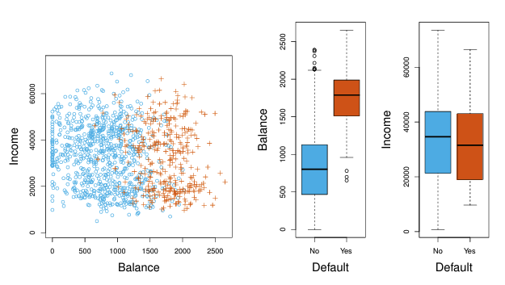
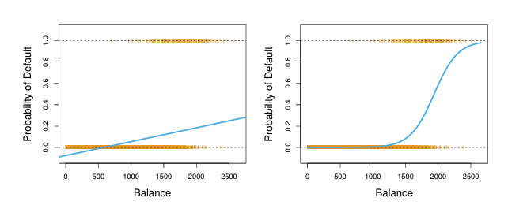
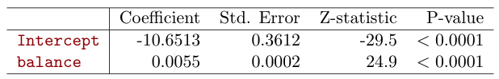
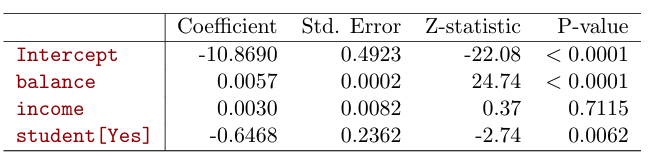

```{r setup, include=FALSE}
knitr::opts_chunk$set(
  echo = TRUE,comment = '', fig.align = 'center'  , out.width="80%"
)
knitr::include_graphics
library(ggplot2)
```

## Reference

Gareth James, Daniela Witten, Trevor Hastie and Robert Tibshirani, 
*An Introduction to Statistical Learning: with Applications in R*. 

## Objectives 

Students will

- Understand what is classification

- Know the difference between linear regression and logistic regression

- Know how to construct confusion matrix and calculate the assessment metrics

- Know how to derive the coefficients for the logistic regression

- Know how to use R to conduct logistic regression, predict the label, and assess the model

## Classification

- Qualitative variables take values in an unordered set $C$, such as: 

  - eye color $\in \{\text{brown, blue, green}\}$ 

  - email $\in \{\text{spam, ham}\}$ 

- Given a feature vector $X$ and a qualitative response $Y$ taking values in the set $C$, the classification task is to build a function $C(X)$ that takes as input the feature vector $X$ and predicts its value for $Y$ ; i.e. $C(X) \in C$. 

- Often we are more interested in estimating the probabilities that $X$ belongs to each category in $C$.


### Process of the Classification

- Given a collection of records (*training set*): each record contains a set of **attributes**, one of the attributes is the **class**.

- Find a *model* for class attribute as a function of the values of other attributes.

- Goal: **previously unseen** records should be assigned a class as accurately as possible.

- A *test set* is used to determine the accuracy of the model. Usually, the given data set is divided into training and test sets, with training set used to build the model and test set used to validate it.


#### Example: Credit Card Default

```{r,echo = FALSE}

```

**Question**: Can we use Linear Regression?

Suppose for the `Default` classification task that we code
$$ Y = \begin{cases}
0 & \text{if No} \\
1 & \text{if Yes}
\end{cases}$$

Can we simply perform a linear regression of $Y$ on $X$ and classify as Yes if $\hat{Y} > 0.5$?


- In this case of a binary outcome, linear regression does a good job as a classifier, and is equivalent to **linear discriminant analysis** which we discuss later. 

- Since in the population $E(Y|X = x) = \text{P}(Y = 1|X = x)$, we might think that regression is perfect for this task.

- However,linear regression might produce probabilities less than zero or bigger than one. **Logistic regression** is more appropriate.

#### Linear versus Logistic Regression

```{r,echo = FALSE}

```

The orange marks indicate the response $Y$,either 0 or 1. Linear regression does not estimate 
$\text{P}(Y=1|X)$ well. **Logistic regression** seems well suited to the task.


### Model Evaluation

In our class, we will focus on binary classification and predictive capability of a model 
rather than how fast it takes to classify or build models. We will use positive (1) to denote the category we care more. For example, we care more about the spam emails than ham emails.

Before introducing the evaluation metrics, we first introduce the *confusion matrix*.

#### Confusion Matrix

<table>
  <tr>
    <th rowspan="2" style="background-color:#cce6ff;">ACTUAL CLASS</th>
    <th colspan="2" style="background-color:#cce6ff;">PREDICTED CLASS</th>
  </tr>
  <tr>
    <th>Class=Yes</th>
    <th>Class=No</th>
  </tr>
  <tr>
    <td><b>Class=Yes</b></td>
    <td>TP (True Positive) </td>
    <td>FN (False Negative)  </td>
  </tr>
  <tr>
    <td><b>Class=No</b></td>
    <td>FP (False Positive)</td>
    <td>TN (True Negative)</td>
  </tr>
</table>

#### Evaluation Metric

- Most widely-used metric:*Accuracy*

$$ Accuracy = \frac{TP +TN}{TP+FN+FP+FN}$$

**Limitation of Accuracy**:

Consider a binary-class problem,

  - Number of Class 0 examples = 9990
  - Number of Class 1 examples = 10

If model predicts everything to be class 0, accuracy is 99.9%.
Accuracy is **misleading** because model does not detect any class 1
example.  

- Other measures

  - Precision(p)
  $$p = \frac{TP}{TP+FP}$$
  
  - Recall(r)
  $$r = \frac{TP}{TP+FN}$$
  
  - F-measure(F)
  $$F = \frac{2TP}{2TP+FN+FP}$$


## Logistic Regression

### General Idea of Logistic Regression

Suppose we only have *two* classes

\begin{align*}
g(x) = \log{\frac{p(y=1|X)}{p(y=0|X)}} &= \theta^T X \\
\Leftrightarrow \log{\frac{p(y=1|X)}{1-p(y=1|X)}} &= \theta^TX \\
\Leftrightarrow  \frac{p(y=1|X)}{1-p(y=1|X)} &= \exp(\theta^TX)\\
\Leftrightarrow  p(y=1|X)&=\exp(\theta^TX)[1-p(y=1|X)]\\
\Leftrightarrow  [1+\exp(\theta^TX)]p(y=1|X)&=\exp(\theta^TX)\\
\Leftrightarrow p(y=1|X) = \frac{\exp(\theta^TX)}{1+ \exp(\theta^TX)}& 
=\frac{1}{1+\exp(-\theta^TX)}
\end{align*}

Goal: Find $\theta$

**Question**: How to find $\theta$

Error \# 1: Classify 0 as 1
$$X^* = \{x_i|y_i = 0 \text{ and }\theta^T x_i > 0\}$$
Error \# 2: Classify 1 as 0
$$X^{**} = \{x_i|y_i = 1 \text{ and } \theta^T x_i < 0\}$$
Consider error function
$$E(\theta) = \# X^* + \# X^{**}$$
Find $$\theta^* =\arg\min_{\theta} E(\theta)$$

#### Revisit Example: Credit Card Default

```{r,echo = FALSE}

```

Lets write $p(X) = \text{P}(Y = 1|X)$ for short and consider using `balance` to predict **default**.
Logistic regression uses the form 
$$ p(X) = \frac{\exp(\beta_0+\beta_1 X )}{1+\exp(\beta_0+\beta_1 X)}.$$
It is easy to see that no matter what values $\beta_0$, $\beta_1$ or $X$ take, $p(X)$ will have values between 0 and 1.We pick $\beta_0$ and 
$\beta_1$ to maximize the likelihood of the observed data or minimize the misclassification error.

In R we use the `glm` function and get the following result.

```{r,echo = FALSE}

```


What is our estimated probability of default for someone with a balance of $1000?

$$\hat{p}(X) = \frac{\exp(\beta_0+\beta_1 X )}{1+\exp(\beta_0+\beta_1 X)} = 
\frac{\exp(-10.6513+ 0.0055\times 1000 )}{1+\exp(-10.6513+ 0.0055\times 1000)} =0.006.$$

We can also extend the logistic regression model to more than one predictor.

$$p(X) = \frac{\exp(\beta_0+\beta_1 X_1+\cdots + \beta_pX_p )}{1+\exp(\beta_0+\beta_1 X+\cdots + \beta_pX_p)}.$$


```{r,echo = FALSE}

```

What can we learn from the output?

### South African Heart Disease in R

- 160 cases of MI (myocardial infarction) and 302 controls (all male in age range 15-64), from Western Cape, South Africa in early 80s. 

- Overall prevalence very high in this region: 51%. 

- Measurements on seven predictors (risk factors). 

- Goal is to identify relative strengths and directions of risk factors. 

- This was part of an intervention study aimed at educating the public on healthier diets

```{r summary}
# import ElemStatLearn
library(ElemStatLearn)
summary(SAheart)
pairs(SAheart[,1:7],col= ifelse(SAheart$chd==1,'red','blue'))
```

#### Split the data set into training and test.

```{r split}
i <- sample(2, nrow(SAheart), replace=TRUE, prob=c(0.8, 0.2))
SAtrainingData <- SAheart[i==1,]
SAtestData <- SAheart[i==2,]
summary(SAtrainingData)
summary(SAtestData)
```

#### Fit the training data

```{r training}
heartfit<-glm(chd~.,data=SAtrainingData,family=binomial) 
summary(heartfit)
```

#### Predict the training data and calculate the confusion matrix

```{r}
mypred <- predict(heartfit,SAtrainingData)
library(e1071) # for sigmoid function
p1=sigmoid(mypred)
y=as.numeric(p1>0.5)
confMat <- table(SAtrainingData$chd,y)
print(confMat)
#accuracy is
sum(diag(confMat))/sum(confMat)
#precision is
confMat[2,2]/(confMat[2,2]+confMat[1,2])
#recall is
confMat[2,2]/(confMat[2,2]+confMat[2,1])
```


#### Predict the test data and calculate the confusion matrix

```{r}
mypred <- predict(heartfit,SAtestData)
p1=sigmoid(mypred)
y=as.numeric(p1>0.5)
confMat <- table(SAtestData$chd,y)
print(confMat)
#accuracy is
sum(diag(confMat))/sum(confMat)
#precision is
confMat[2,2]/(confMat[2,2]+confMat[1,2])
#recall is
confMat[2,2]/(confMat[2,2]+confMat[2,1])
```

#### In-Class Exercise: Logistic Regression

[Obtaining the Breat Cancer Wisconsin data set](https://archive.ics.uci.edu/dataset/15/breast+cancer+wisconsin+original)

- Split the dataset to training and test datasets

- Use logistic regression to build a classifier on the training dataset 

- Predict the test dataset and generate a confusion matrix to calculate accuracy, precision, and recall

