```{r setup, include=FALSE}
knitr::opts_chunk$set(
  echo = TRUE,comment = '', fig.align = 'center'  , out.width="80%"
)
knitr::include_graphics
library(ggplot2)
```

## Reference

- Gareth James, Daniela Witten, Trevor Hastie and Robert Tibshirani, 
*An Introduction to Statistical Learning: with Applications in R*. 

- Pang-Ning Tan,Michael Steinbach, Vipin Kumar, [*Introduction to Data Mining*, 2nd edition
Published by Pearson (January 4, 2018) ](https://www-users.cse.umn.edu/~kumar001/dmbook/index.php)

## Objectives 

Students will


- Understand the idea of support vector machine

- Understand the idea of neural network

- Understand the idea of tree based methods

- Know how to use conduct SVM, NN, and decision tree to predict the labels and 
assess the models in R

## Support Vector Machine

**Key idea**: find a linear hyperplane (decision boundary) that will separate the data.

If we cannot, we get creative in two ways:

- We soften what we mean by *separates*, and

- We enrich and enlarge the feature space so that separation is possible.

### What is a Hyperplane?

- A *hyperplane* in $p$ dimensions is a flat affine subspace of
dimension $p − 1$.

- In general the equation for a hyperplane has the form

$$\beta_0 + \beta_1X_1 + \beta_2X_2 + \cdots + \beta_pX_p = 0.$$

- In $p = 2$ dimensions a hyperplane is a line.

- If $β_0 = 0$, the hyperplane goes through the origin, otherwise not.

- The vector $\beta = (\beta_1, \beta_2, \cdots , \beta_p)$ is called the *normal vector*
--- it points in a direction orthogonal to the surface of a
hyperplane.


#### Hyperplane in 2 Dimensions

```{r,echo = FALSE}
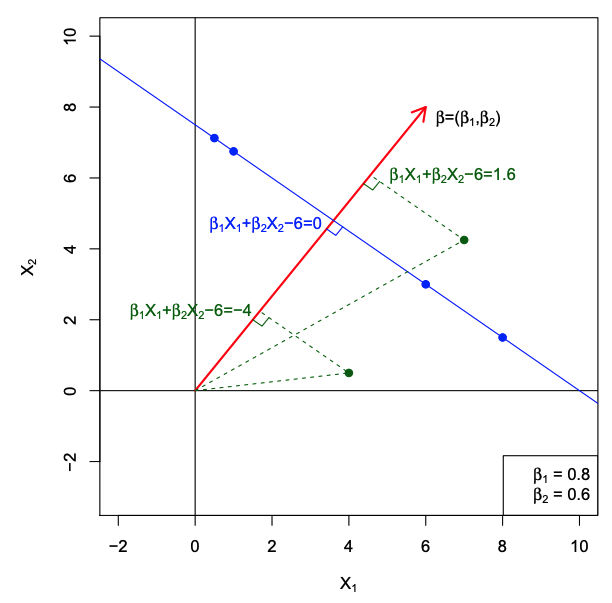
```

#### Separating Hyperplanes


```{r,echo = FALSE}
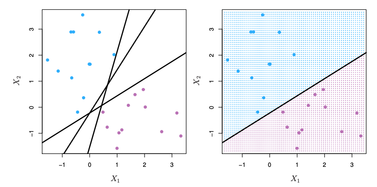
```

- If $f(X) = \beta_0 + \beta_1X_1 + \beta_2X_2 + \cdots + \beta_pX_p$, then $f(X) > 0$ for points on
one side of the hyperplane, and $f(X) < 0$ for points on the other.

- If we code the colored points as $Y_i = +1$ for blue, say, and
$Y_i = −1$ for mauve, then if $Y_i\cdot f(X_i) > 0$ for all $i$, $f(X) = 0$
defines a separating hyperplane.

#### Maximal Margin Classifier

Among all separating hyperplanes, find the one that makes the
**biggest gap or margin** between the two classes.

```{r,echo = FALSE}
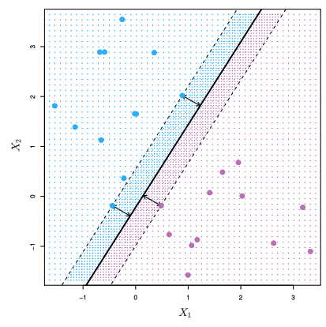
```


Constrained optimization problem

\begin{align*}
& \max_{\beta_0,\beta_1,\ldots,\beta_p} M \\
\text{subject to} & \sum_{j=1}^p \beta_j^2 =1, \\
& y_i(\beta_0+\beta_1x_{i1} + \ldots + \beta_px_{ip}) \ge M \forall i =1,\ldots,N.
\end{align*}

This can be rephrased as a convex quadratic program, and
solved efficiently. The function `svm()` in package `e1071` solves
this problem efficiently.


### Support Vector Machine in R

We still investigate South African Heart Disease dataset.

- 160 cases of MI (myocardial infarction) and 302 controls (all male in age range 15-64), from Western Cape, South Africa in early 80s. 

- Overall prevalence very high in this region: 51%. 

- Measurements on seven predictors (risk factors). 

- Goal is to identify relative strengths and directions of risk factors. 

- This was part of an intervention study aimed at educating the public on healthier diets

```{r summary}
# import ElemStatLearn
library(ElemStatLearn)
summary(SAheart)
pairs(SAheart[,1:7],col= ifelse(SAheart$chd==1,'red','blue'))
```

#### Split the data set into training and test.

```{r split}
i <- sample(2, nrow(SAheart), replace=TRUE, prob=c(0.8, 0.2))
SAtrainingData <- SAheart[i==1,]
SAtestData <- SAheart[i==2,]
summary(SAtrainingData)
summary(SAtestData)
```

#### Fit the training data and predict the training data and calculate the confusion matrix

```{r SVM}
#Need to include package e1071
library(e1071)
mysvm<- svm(as.factor(chd)~.,data=SAtrainingData)
predsvm<-predict(mysvm,SAtrainingData)
confMat<-table(SAtrainingData$chd,predsvm)
print(confMat)
#accuracy is
sum(diag(confMat))/sum(confMat)
#precision is
confMat[2,2]/sum(confMat[,2])
#recall is
confMat[2,2]/sum(confMat[2,])
```

#### Predict the test data and calculate the confusion matrix

```{r}
predsvm<-predict(mysvm,SAtestData)
confMat<-table(SAtestData$chd,predsvm)
print(confMat)
#accuracy is
sum(diag(confMat))/sum(confMat)
#precision is
confMat[2,2]/sum(confMat[,2])
#recall is
confMat[2,2]/sum(confMat[2,])
```


#### In-Calss Exercise: Support Vector Machine

[Obtaining the Breat Cancer Wisconsin data set](https://archive.ics.uci.edu/dataset/17/breast+cancer+wisconsin+diagnostic)

- Split the dataset to training and test datasets

- Use support vector machine to build a classifier on the training dataset 

- Predict the test dataset and generate a confusion matrix to calculate accuracy, precision, and recall

## Artificial Neural Network (ANN)

#### An Example

Output $Y$ is 1 at least two of the three inputs are equal to 1.

```{r,echo = FALSE}
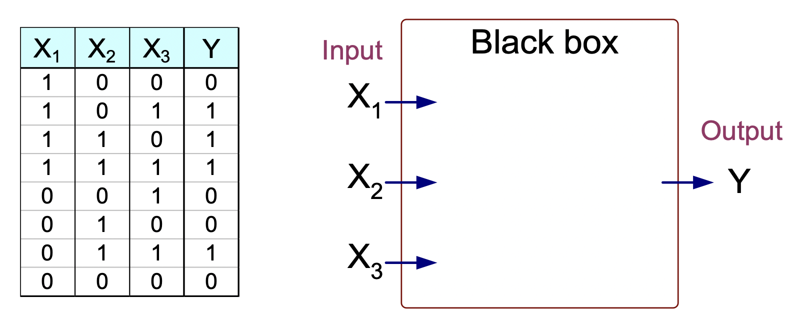
```

How to determine the black box?

\begin{align*}
Y &= I (0.3 X_1+ 0.3 X_2  + 0.3X_3 - 0.4  > 0)\\
\text{where } & I(z) = \begin{cases}
1 & \text{ if } z \text{ is ture}\\
0 & \text{otherwise}
\end{cases}
\end{align*}

```{r,echo = FALSE}
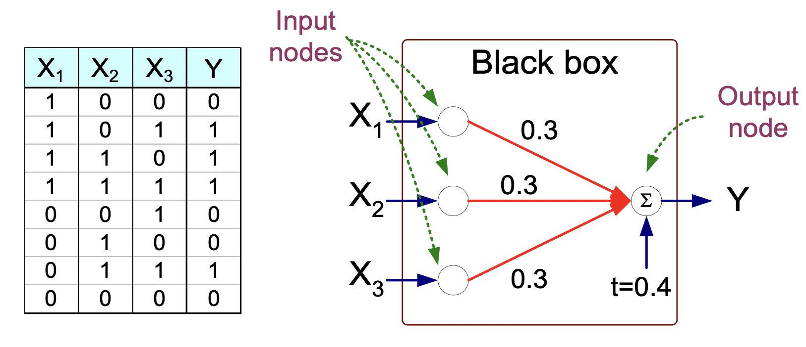
```

- Model is an assembly of inter-connected nodes and weighted links
- Output node sums up each of its input value according to the weights of its links
- Compare output node against some threshold $t$

### General Structure of ANN

```{r,echo = FALSE}
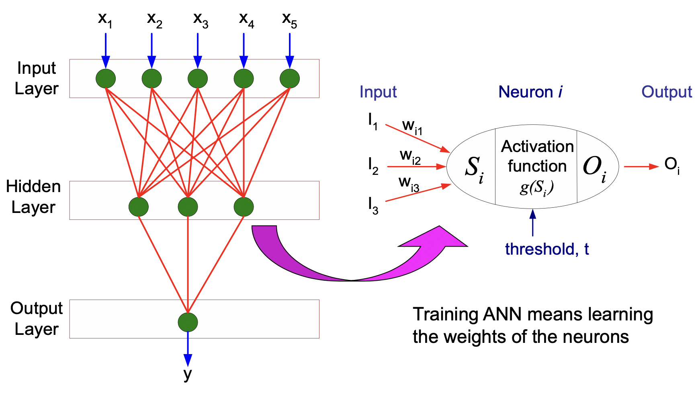
```

### Algorithm for learning ANN

- Initialize the weights ($w_0, w_1, \ldots, w_k$)

- Adjust the weights in such a way that the output of ANN is consistent with class labels of training examples, where the objective function is
$$E = \sum_i\left[Y_i -f(w_i,X_i)\right]^2$$
The goal is to find the weights $w_i$'s that minimize the above objective function


### Neural Network in R

We still investigate South African Heart Disease dataset with the same split.

- 160 cases of MI (myocardial infarction) and 302 controls (all male in age range 15-64), from Western Cape, South Africa in early 80s. 

- Overall prevalence very high in this region: 51%. 

- Measurements on seven predictors (risk factors). 

- Goal is to identify relative strengths and directions of risk factors. 

- This was part of an intervention study aimed at educating the public on healthier diets

#### Fit the training data and predict the training data and calculate the confusion matrix

```{r NN}
#load package 
library("nnet")
# 2 Layers
mynnet<-nnet(as.factor(chd)~.,data=SAtrainingData,size=3,maxit= 200)
prednet<-predict(mynnet,SAtrainingData,type="class")
# Fix the levels to ensure a 2x2 confusion matrix
classes <- levels(as.factor(SAtrainingData$chd))

confMat <- table(
  factor(SAtrainingData$chd, levels = classes),
  factor(prednet, levels = classes)
)
print(confMat)

# Accuracy
sum(diag(confMat)) / sum(confMat)

# Precision
if (sum(confMat[, 2]) == 0) {
  NA_real_
} else {
  confMat[2, 2] / sum(confMat[, 2])
}

# Recall
if (sum(confMat[2, ]) == 0) {
  NA_real_
} else {
  confMat[2, 2] / sum(confMat[2, ])
}
```

#### Predict the test data and calculate the confusion matrix

```{r}
prednet <- predict(mynnet, SAtestData, type = "class")

confMat <- table(
  factor(SAtestData$chd, levels = classes),
  factor(prednet, levels = classes)
)

print(confMat)

# Accuracy
sum(diag(confMat)) / sum(confMat)

# Precision
if (sum(confMat[, 2]) == 0) {
  NA_real_
} else {
  confMat[2, 2] / sum(confMat[, 2])
}

# Recall
if (sum(confMat[2, ]) == 0) {
  NA_real_
} else {
  confMat[2, 2] / sum(confMat[2, ])
}
```


#### In-Calss Exercise: Neural Network

[Obtaining the Breat Cancer Wisconsin data set](https://archive.ics.uci.edu/dataset/15/breast+cancer+wisconsin+original)

- Split the dataset to training and test datasets

- Use neural network to build a classifier on the training dataset 

- Predict the test dataset and generate a confusion matrix to calculate accuracy, precision, and recall

## Tree-based Methods

- These involve *stratifying* or *segmenting* the predictor space into a number of simple regions.

- Since the set of splitting rules used to segment the predictor space can be summarized in a tree, these types of approaches are known as **decision-tree** methods.

### Pros and Cons

- Tree-based methods are simple and useful for interpretation. 

- However they typically are not competitive with the best supervised learning approaches in terms of prediction accuracy. 

- We will discuss random forests in Module 8. This method grows multiple trees which are then combined to yield a single consensus prediction. 

- Combining a large number of trees can often result in dramatic improvements in prediction accuracy, at the expense of some loss interpretation.

- Tree-based methods can be used in both regression and classification. We focus on classification.

#### Examle of A Decision Tree

```{r,echo = FALSE}
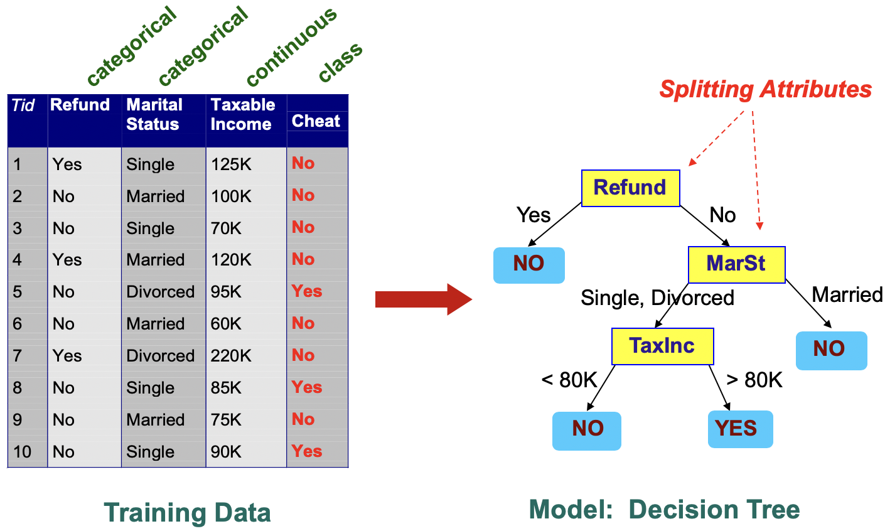
```

## Trees Induction

- *Greedy strategy*: Split the records based on an attribute test that optimizes certain criterion.

- Issues:
  - Determine how to split the records
    - How to specify the attribute test condition?
    - How to determine the best split?
  - Determine when to stop splitting
  
### How to Specify Test Condistion?

- Depends on attribute types
  - Nominal
  - Ordinal
  - Continuous
- Depends on number of ways to split
  - Binary split
  - Multi-way split

#### Splitting Based on Nominal Attributes

- Multi-way split: Use as many partitions as distinct values.

```{r,echo = FALSE, out.width="30%"}
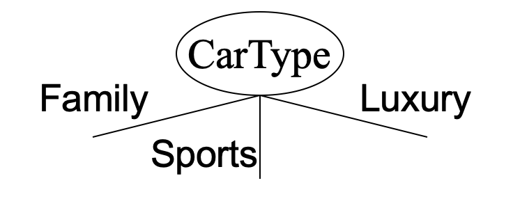
```

- Binary split: Divides values into two subsets. Need to find optimal
partitioning.

```{r,echo = FALSE}
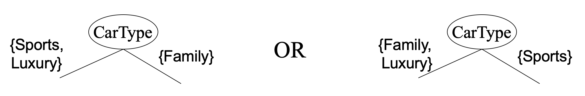
```

#### Splitting Based on Ordinal Attributes

- Multi-way split:

```{r,echo = FALSE,out.width="30%"}
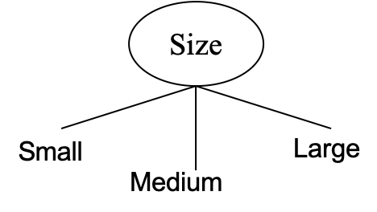
```

- Binary split: 

```{r,echo = FALSE}
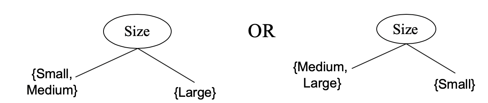
```

**Question**: What about this split?

```{r,echo = FALSE,out.width="30%"}
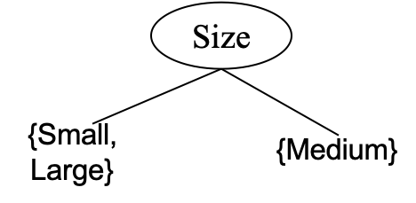
```


#### Splitting Based on Continuous Attributes

- *Discretization* to form an ordinal categorical attribute

- *Binary Decision*: $A < v$ or $A \ge v$

```{r,echo = FALSE,out.width="60%"}
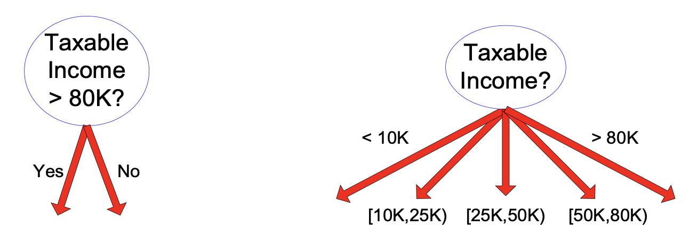
```


### How to determine the Best Split

- Greedy approach: Nodes with *homogeneous* class distribution are
preferred
- Need a measure of node impurity

```{r,echo = FALSE,out.width="60%"}
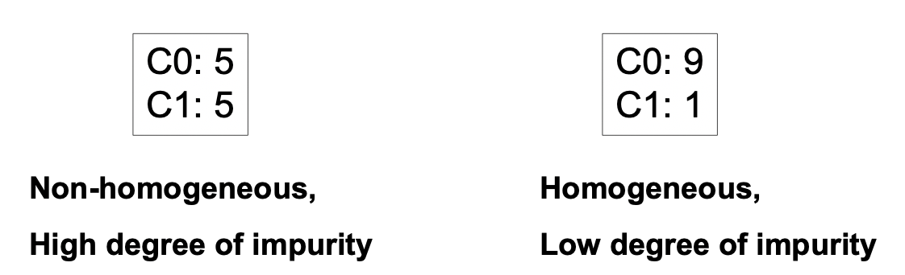
```

### Measures of Node Impurity

- Gini Index

For a given node $t$:
$$\text{GINI}(t) = 1- \sum_{j} [p(j|t)]^2$$
where $p(j|t)$ is the relative frequency of class $j$ at node $t$.

```{r,echo = FALSE,out.width="60%"}
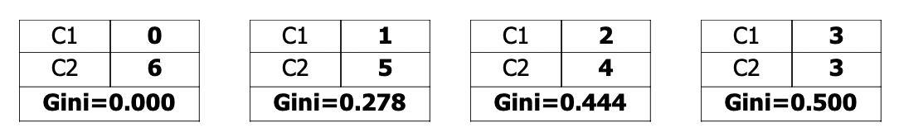
```

  - **Maximum** $1 - 1/n_c$: records are *equally distributed* among all classes
  
  - **Minimum** 0: all records belong to *one* class
  
- Entropy

For a given node $t$:
$$\text{Entropy} (t)= -\sum_j p(j|t) \log_2{p(j|t)},$$
		where $p(j|t)$ is the relative frequency of class $j$ at node $t$ \pause
	
```{r,echo = FALSE,out.width="60%"}
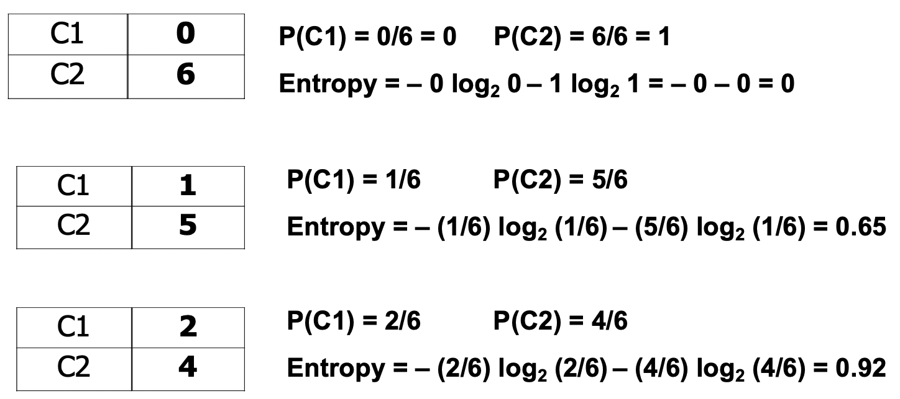
```

  -**Maximum** $\log_2{n_c}$: records are *equally distributed* among all classes
  
  -**Minimum** 0: all records belong to *one* class	

- Misclassification error

For a given node $t$:

$$\text{Classification Error}(t) = 1-\max_j p(j|t) $$
	where $p(j|t)$ is the relative frequency of class $j$ at node $t$


```{r,echo = FALSE,out.width="60%"}
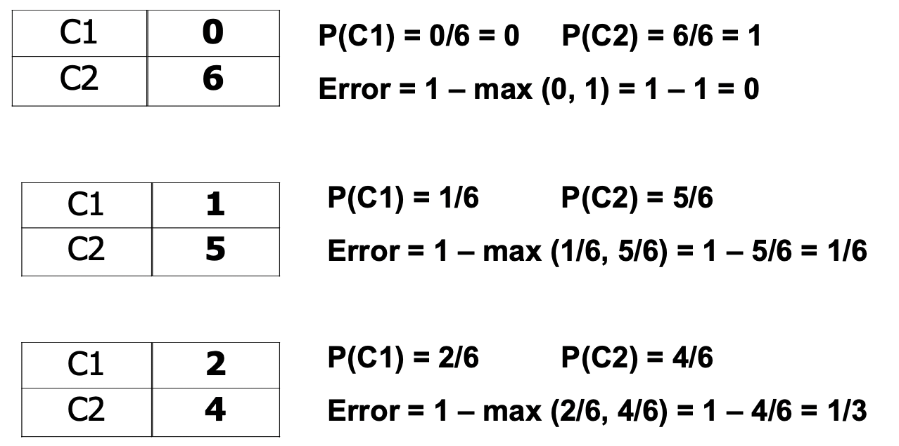
```

  - **Maximum** $1-1/n_c$: records are *equally distributed* among all classes
  
  - **Minimum** 0: all records belong to *one* class

For a 2-class problem:

```{r,echo = FALSE,out.width="60%"}
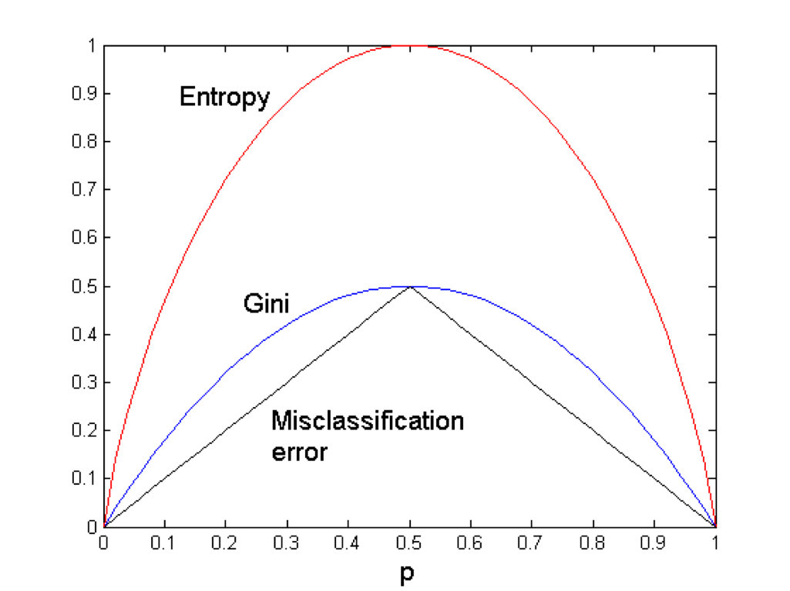
```

We can use *Information Gain* or *Gain Ratio* to determine if we want to grow the tree.

### Stopping Criteria for Tree Induction

- Stop expanding a node when all the records belong to the same
class
- Stop expanding a node when all the records have similar attribute
values
- Early termination

### How to Address overfitting

- Pre-Pruning (Early Stopping Rule)
  - Typical stopping conditions for a node:
    - Stop expanding a node when all the records belong to the same class
    - Stop expanding a node when all the records have similar attribute values
  - More restrictive conditions:
    - Stop if number of records is less than some user-specified threshold
    - Stop if class distribution of instances are independent of the available features 
    (e.g., using $\chi^2$ test)
    - Stop if expanding the current node does not improve impurity measures (e.g., Gini or information gain)
    
- Post-Pruning
  - Grow decision tree to its entirety and trim the nodes of the decision tree in a bottom-up fashion
  - If generalization error improves after trimming, replace sub-tree by a leaf node
  
### Decision Tree in R

We still investigate South African Heart Disease dataset with the same split.

- 160 cases of MI (myocardial infarction) and 302 controls (all male in age range 15-64), from Western Cape, South Africa in early 80s. 

- Overall prevalence very high in this region: 51%. 

- Measurements on seven predictors (risk factors). 

- Goal is to identify relative strengths and directions of risk factors. 

- This was part of an intervention study aimed at educating the public on healthier diets

#### Fit the training data and predict the training data and calculate the confusion matrix

```{r decision}
#Need to include package rpart
library(rpart)
myFormula<-as.factor(SAtrainingData$chd)~.
mytree<- rpart(myFormula,data=SAtrainingData)
print(mytree)

#Plot a fancy decision tree
#need package rpart.plot
library(rpart.plot)
rpart.plot(mytree, uniform=TRUE, main="Classification Tree for Heart Disease")
```

#### Predict the test data and calculate the confusion matrix

```{r}
treepred <- predict(mytree,newdata=SAtestData,type="class")
confMat<-table(SAtestData$chd,treepred)
print(confMat)
#accuracy is
sum(diag(confMat))/sum(confMat)
#precision is
confMat[2,2]/sum(confMat[,2])
#recall is
confMat[2,2]/sum(confMat[2,])
```


### Prune the tree and predict the test data and calculate the confusion matrix

```{r}
mytree_prune<- prune(mytree, cp = 0.04)
print(mytree_prune)
rpart.plot(mytree_prune,uniform=TRUE, main="Pruned Classification Tree for Heart Disease")
treepred <- predict(mytree_prune,newdata=SAtestData,type="class")
confMat<-table(SAtestData$chd,treepred)
print(confMat)
#accuracy is
sum(diag(confMat))/sum(confMat)
#precision is
confMat[2,2]/sum(confMat[,2])
#recall is
confMat[2,2]/sum(confMat[2,])
```


#### In-Calss Exercise: Decision Tree

[Obtaining the Breat Cancer Wisconsin data set](https://archive.ics.uci.edu/dataset/15/breast+cancer+wisconsin+original)

- Split the dataset to training and test datasets


- Use decision tree to build a classifier on the training dataset 


- Predict the test dataset and generate a confusion matrix to calculate accuracy, precision, and recall

