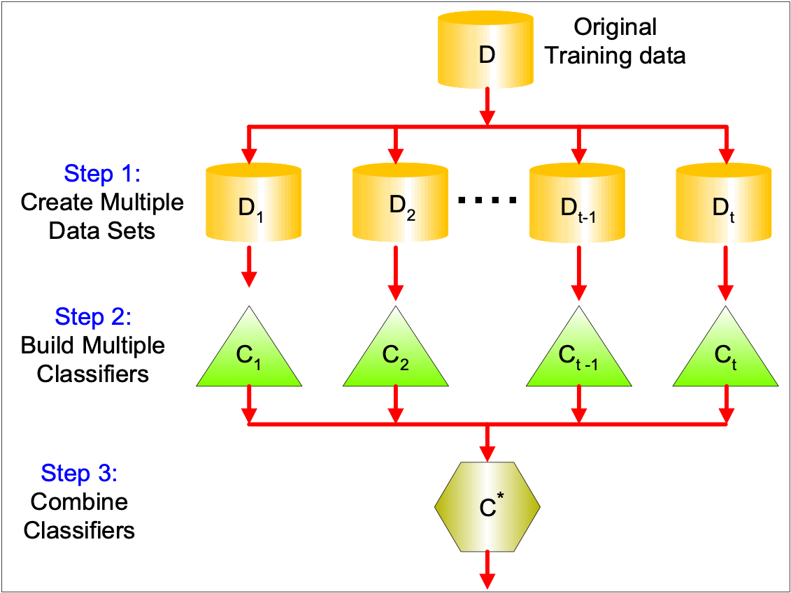
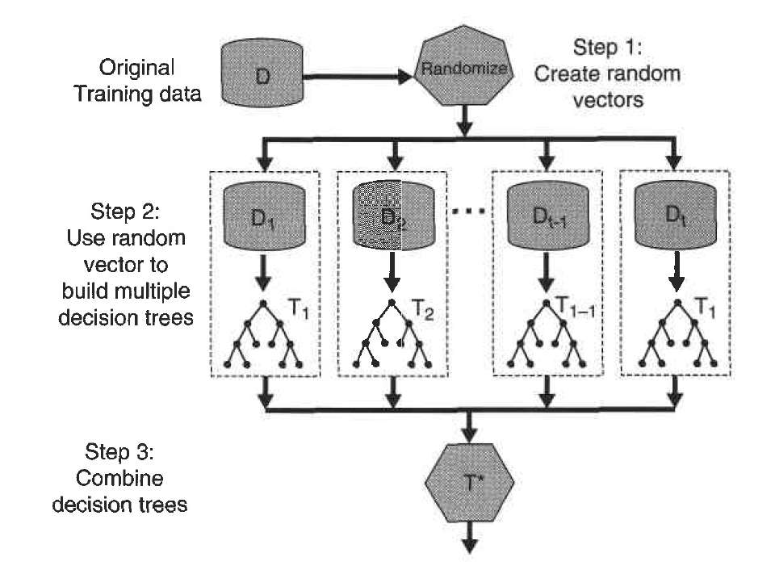

```{r setup, include=FALSE}
knitr::opts_chunk$set(
  echo = TRUE,comment = '', fig.align = 'center'  , out.width="80%"
)
knitr::include_graphics
library(ggplot2)
```

## Reference

- Pang-Ning Tan,Michael Steinbach, Vipin Kumar, *Introduction to Data Mining*, 2nd edition
Published by Pearson (January 4, 2018) 
https://www-users.cse.umn.edu/~kumar001/dmbook/index.php


## Objectives 

Students will

- Understand the idea of ensemble methods

- Know how to use R to conduct random forest

## Ensemble Methods

- Construct a set of classifiers from the training data

- Predict class label of previously unseen records by aggregating predictions made by multiple classifiers

### Genearl Idea

```{r,echo = FALSE}

```

**Question**: Why does it work?

Suppose there are $25$ base classifiers

- Each classifier has error rate, $\varepsilon = 0.35$

- Assume classifiers are independent

- Probability that the ensemble classifier makes a wrong prediction:

	$$\sum_{i=13}^{25} \begin{pmatrix} 25 \\ i \end{pmatrix} \varepsilon^i (1-\varepsilon)^{25-i} = 0.06$$

### Methods for Constructing an Ensember Classifier

- Manipulating the training set: multiple training sets are created by resampling the original data according to some sampling
distribution
  - Bagging
  - Boosting

- Manipulating the input features: a subset of input features is
chosen to form each training set
e.g. Random Forest

- Manipulating the class labels
This method can be used when the number of classes is sufficiently large.
 
- Manipulating the learning algorithm

#### Example of Random Forest

```{r,echo = FALSE}

```

### Random Forest in R

We still investigate South African Heart Disease dataset.

- 160 cases of MI (myocardial infarction) and 302 controls (all male in age range 15-64), from Western Cape, South Africa in early 80s. 

- Overall prevalence very high in this region: 51%. 

- Measurements on seven predictors (risk factors). 

- Goal is to identify relative strengths and directions of risk factors. 

- This was part of an intervention study aimed at educating the public on healthier diets

```{r summary}
# import ElemStatLearn
library(ElemStatLearn)
summary(SAheart)
pairs(SAheart[,1:7],col= ifelse(SAheart$chd==1,'red','blue'))
```

#### Split the data set into training and test.

```{r split}
i <- sample(2, nrow(SAheart), replace=TRUE, prob=c(0.8, 0.2))
SAtrainingData <- SAheart[i==1,]
SAtestData <- SAheart[i==2,]
summary(SAtrainingData)
summary(SAtestData)
```

#### Fit the training data and predict the training data and calculate the confusion matrix

```{r SVM}
#Need to include package randomForest
library(randomForest)
myrf<- randomForest(as.factor(chd)~.,data=SAtrainingData)
predrf<-predict(myrf,SAtrainingData)
confMat<-table(SAtrainingData$chd,predrf)
print(confMat)
#accuracy is
sum(diag(confMat))/sum(confMat)
#precision is
confMat[2,2]/sum(confMat[,2])
#recall is
confMat[2,2]/sum(confMat[2,])
```

#### Predict the test data and calculate the confusion matrix

```{r}
predrf<-predict(myrf,SAtestData)
confMat<-table(SAtestData$chd,predrf)
print(confMat)
#accuracy is
sum(diag(confMat))/sum(confMat)
#precision is
confMat[2,2]/sum(confMat[,2])
#recall is
confMat[2,2]/sum(confMat[2,])
```

#### In-Calss Exercise: Ensemble Methods

[Obtaining the Breat Cancer Wisconsin data set](https://archive.ics.uci.edu/dataset/15/breast+cancer+wisconsin+original)

- Split the dataset to training and test datasets


- Use random forest to build a classifier on the training dataset 


- Predict the test dataset and generate a confusion matrix 
